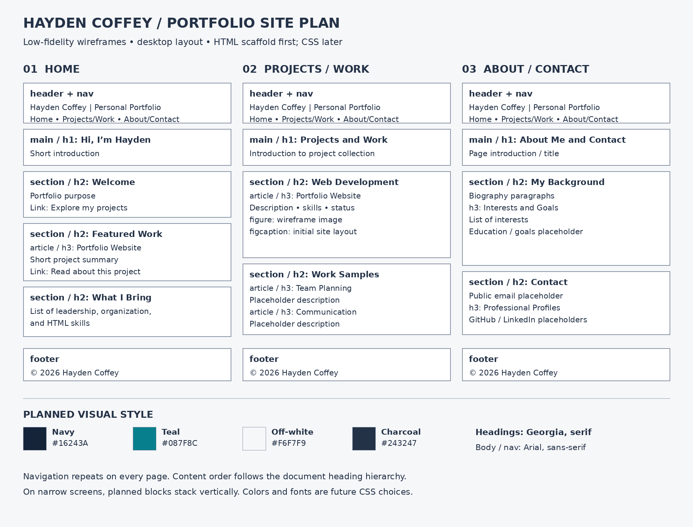

# Hayden Coffey — Personal Portfolio

A site plan and semantic HTML scaffold for a three-page personal portfolio.

## Site Plan / Wireframe

The wireframe shows the intended future layout. The HTML pages intentionally have no CSS and currently use the browser's default layout and fonts.

### Planned Color Palette

| Use | Color | Hex |
| --- | --- | --- |
| Header, footer, headings | Navy | #16243A |
| Links and accents | Teal | #087F8C |
| Page background | Off-white | #F6F7F9 |
| Body text | Charcoal | #243247 |

### Planned Fonts

- Headings: Georgia, with a serif fallback.
- Body and navigation: Arial, with a sans-serif fallback.
- Apply these choices in a future CSS stage; no font downloads are needed.

## Pages

| File | Purpose |
| --- | --- |
| [index.html](index.html) | Introduction, featured project, and strengths |
| [projects.html](projects.html) | Portfolio project, wireframe, and planned work samples |
| [about.html](about.html) | Background, interests, goals, and contact placeholders |

Each page includes the same navigation with relative links, one h1, h2 sections, h3 subsections, and semantic header, nav, main, section, and footer elements. Placeholder work samples and contact details are labeled clearly.

## Open the Site

Download the repository and open `index.html` in a browser. No installation or build tools are required.

## Upload and Submit

1. Create a GitHub repository named `personal-portfolio` (or use your assigned repository).
2. Select **Add file → Upload files** inside the repository.
3. Upload the contents of this folder, including the `assets` folder. Extract the ZIP first; uploading only the ZIP will not make the HTML files and wireframe visible individually.
4. Commit the files and confirm the root contains `index.html`, `projects.html`, `about.html`, and this README, with `assets/wireframe.png` inside `assets`.
5. Submit the repository URL from your browser's address bar. A GitHub Pages deployment is not required for this assignment.
